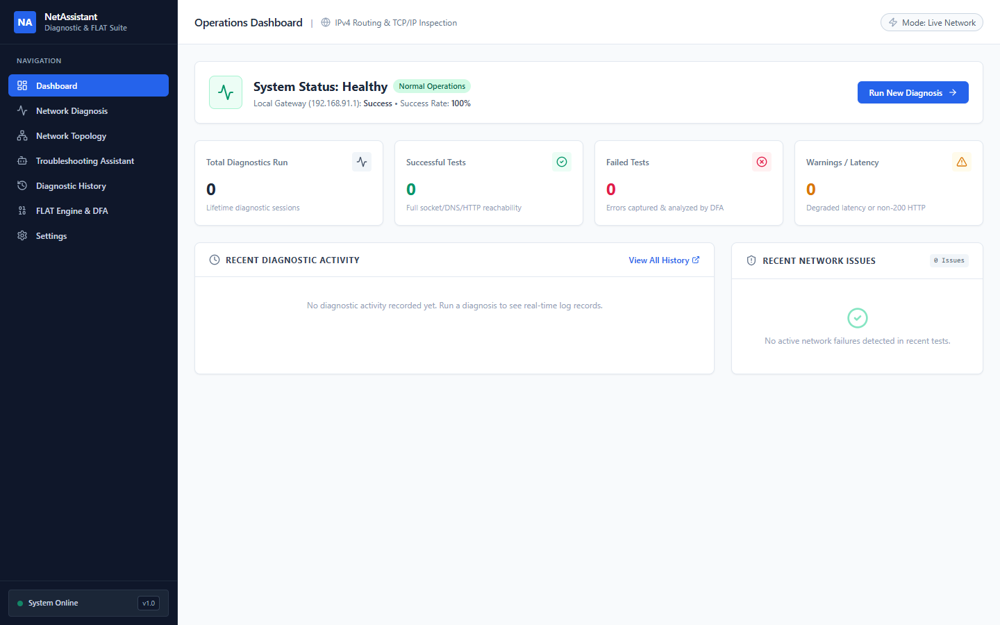
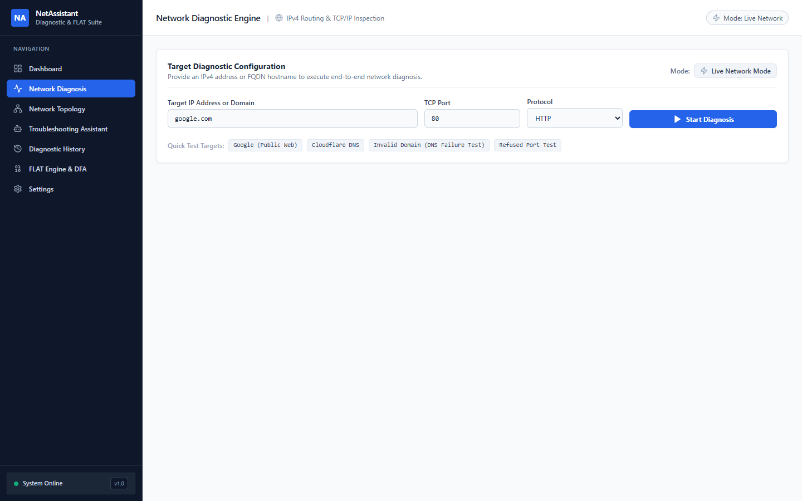
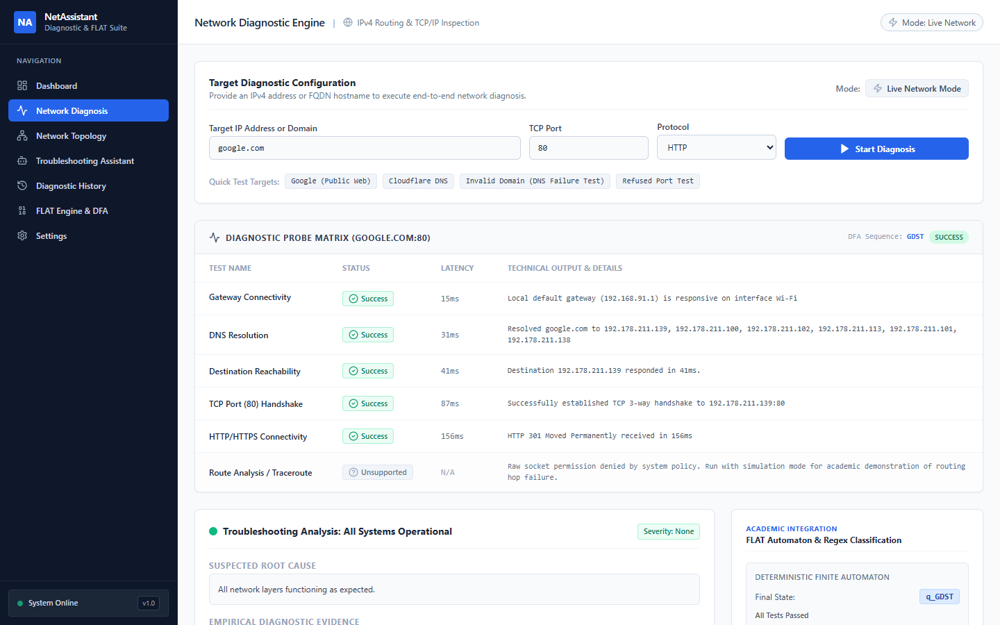
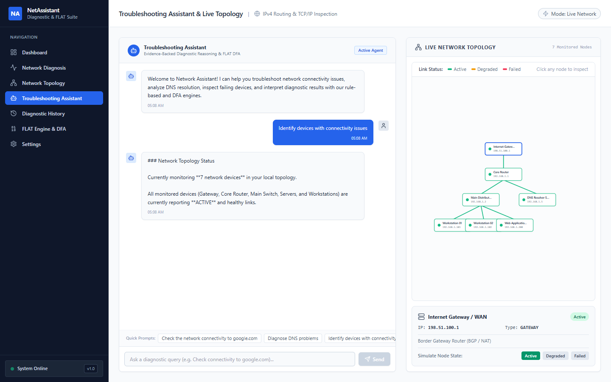
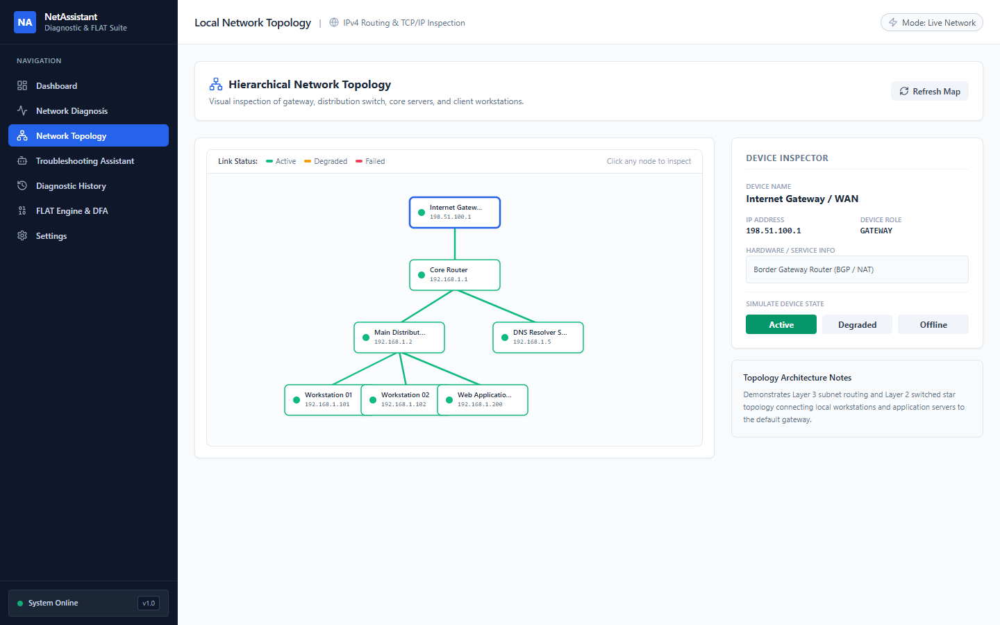
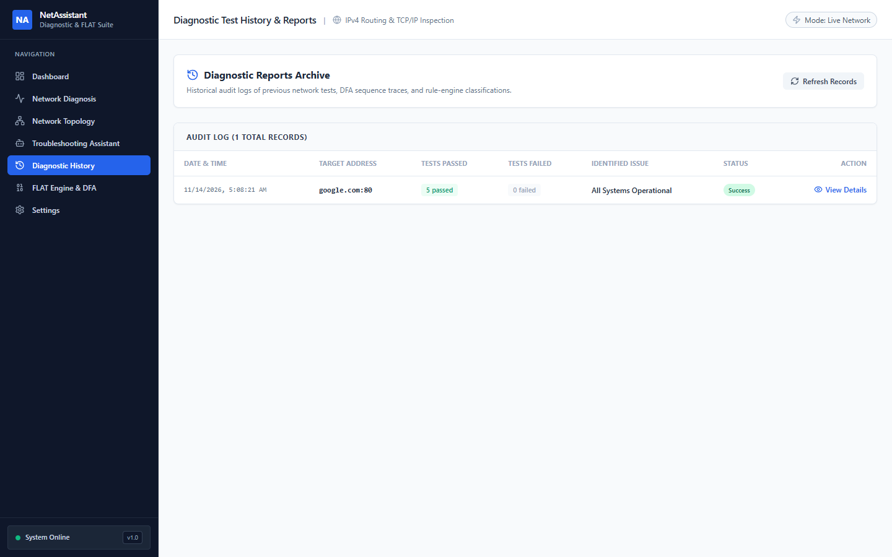
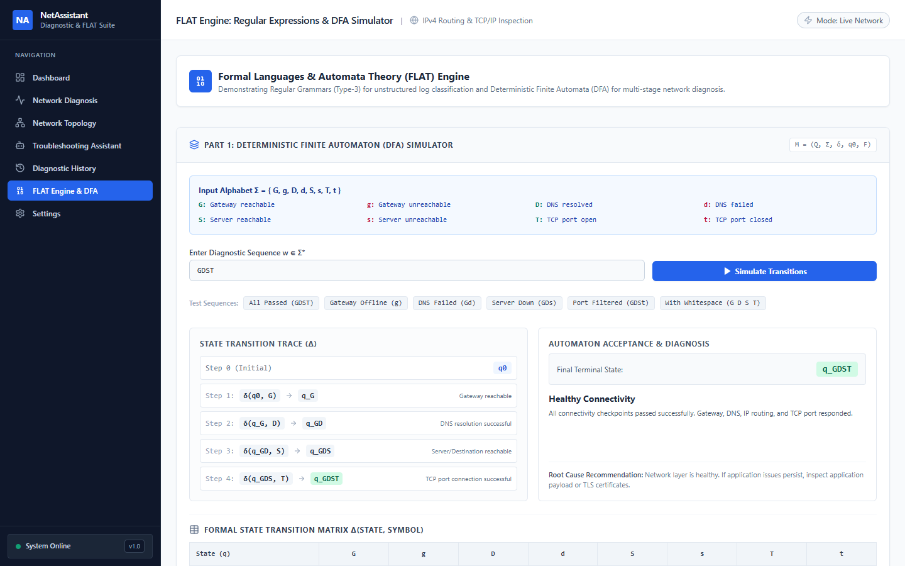

# Automated Network Troubleshooting Assistant

> An intelligent, web-based network diagnostic and troubleshooting platform integrating empirical Computer Networks protocols with Formal Languages & Automata Theory (FLAT).

[](https://github.com/OviyaaSM/Network-Troubleshooting-Assistant)
[](https://network-troubleshooting-assistant.onrender.com)
[](https://network-troubleshooting-assistant.vercel.app)
[](#10-flat-concepts-used)
[](LICENSE)

---

## 1. Project Title
**Automated Network Troubleshooting Assistant**  
Academic & Industrial Capstone Implementation: Computer Networks & Formal Languages and Automata Theory (FLAT).

---

## 2. Project Overview
The **Automated Network Troubleshooting Assistant** is a full-stack, enterprise-grade network monitoring, diagnostic, and remediation assistant inspired by NetBrain's clean, operational design principles. It empowers network engineers, system administrators, and students to diagnose connectivity failures, pinpoint root causes across the TCP/IP stack (Physical, Network, Transport, and Application layers), and receive step-by-step remediation procedures.

Beyond standard network diagnostics, the system bridges empirical network engineering with computer science theory by integrating **Formal Languages and Automata Theory (FLAT)**:
1. **Regular Grammars (Type-3 Chomsky Hierarchy)** parse and classify unstructured socket error tokens and syslog lines.
2. A **Deterministic Finite Automaton (DFA)** models the pipeline of sequential diagnostic tests, tracing state transitions to identify the failure point.

---

## 3. Problem Statement
Troubleshooting modern computer network outages is challenging due to:
- **Disparate Diagnostic Tools:** Users must manually juggle `ping`, `nslookup`, `netstat`, `traceroute`, and `curl`, which lack unified correlation.
- **Cryptic Error Messages:** Operating system socket errors (e.g. `getaddrinfo ENOTFOUND`, `ECONNREFUSED`, `ETIMEDOUT`) are opaque to non-specialists.
- **Root Cause Ambiguity:** A failed web connection may stem from a local gateway outage, upstream recursive DNS failure, firewall packet filtering, or server daemon termination. Without sequential verification, remediation is guesswork.
- **Lack of Theory Integration:** Students frequently study Automata Theory and Networking in silos without understanding how formal languages govern real-world network protocols.

---

## 4. Objectives
- **Automate Multi-Layer Diagnostics:** Orchestrate sequential checks across Gateway, DNS, IP routing, TCP transport, and HTTP application layers in one click.
- **Implement FLAT Academic Principles:** Demonstrate real-world applications of Regular Expressions and Finite State Machines for network state classification.
- **Interactive Conversational Troubleshooting:** Provide an intelligent, two-panel troubleshooting assistant combining natural language queries with a live network topology visualization.
- **Provide Safe Simulation Scenarios:** Allow users to simulate reproducible failure states (e.g., DNS NXDOMAIN, port drop, gateway disconnect) without disrupting production hardware.
- **Deliver a Minimal, Professional Interface:** Adhere to a NetBrain-inspired UI characterized by high information density, clean typography, compact status indicators, and responsive layouts.
- **Full Cloud Deployment:** Deploy a production-ready system utilizing **Render** for the static React frontend and **Vercel** for the serverless Node.js backend with MongoDB persistence.

---

## 5. Features
- **One-Click Diagnostic Pipeline:** Probes Gateway connectivity, DNS resolution latency, ICMP/TCP host reachability, TCP 3-way handshake, HTTP status codes, and route hop availability.
- **FLAT DFA State Machine Engine:** Parses diagnostic symbols ($w \in \Sigma^*$) through a formal 5-tuple DFA ($M = (Q, \Sigma, \delta, q_0, F)$) with real-time transition tracing.
- **Regular Expression Error Classifier:** Compiles robust Type-3 regular expression patterns to classify raw network error strings into standardized codes with confidence scoring.
- **Two-Panel Intelligent Assistant:** Features an evidence-based chat assistant on the left and an interactive network topology diagram on the right.
- **Interactive Topology Map:** Visualizes network nodes (Internet, Gateway, Core Router, Distribution Switch, Servers, Workstations) with status-coded links (Green = Active, Amber = Degraded, Red = Offline) and node inspection sheets.
- **Simulated Fault Injection:** Toggle node states and inject failure presets (e.g. Gateway Down, DNS Resolver Outage, Port Filtered by Firewall) for interactive demos.
- **SSRF & Security Guards:** Enforces strict RFC 1918, loopback, and cloud metadata (169.254.169.254) validation to protect infrastructure against Server-Side Request Forgery.
- **Historical Audit Archive:** Stores detailed test reports, empirical evidence, DFA states, and recommended verification commands with MongoDB and an in-memory fallback.

---

## 6. Technology Stack

### Frontend
- **Framework:** React 18 + Vite
- **Styling:** Tailwind CSS (NetBrain minimal light aesthetic)
- **Icons:** Lucide React
- **Network Graph:** Custom SVG-based Interactive Layered Topology

### Backend
- **Runtime:** Node.js (v20+ / v24)
- **Web Framework:** Express.js (REST API & Vercel Serverless adaptation)
- **Database:** MongoDB with Mongoose ODM + Resilient In-Memory Fallback
- **Networking Modules:** `net`, `dns`, `http`, `https`, `os`
- **Security:** SSRF Validation Middleware, CORS, Helmet

### Testing & Tooling
- **Unit & Integration Testing:** Vitest, Supertest, Testing Library, JSDOM
- **Automated Verification:** Puppeteer Headless Browser
- **Deployment Platforms:** Render (Frontend Static Site) + Vercel (Backend Serverless)

---

## 7. System Architecture

```
┌────────────────────────────────────────────────────────────────────────┐
│                        CLIENT LAYER (Render SPA)                       │
│  React 18 + Vite | Tailwind CSS | Topology Canvas | Assistant Console  │
└───────────────────────────────────┬────────────────────────────────────┘
                                    │ HTTPS / REST API
                                    ▼
┌────────────────────────────────────────────────────────────────────────┐
│                      API GATEWAY & SECURITY LAYER                      │
│        Vercel Serverless Function / Express.js (Node.js Engine)        │
│          ├── CORS Configuration (Render Allowed Origin)                │
│          ├── SSRF Validation & Private IP Filter                       │
│          └── Rate Limiting & Timeout Guard                             │
└──────────────┬─────────────────────────────┬───────────────────────────┘
               │                             │
               ▼                             ▼
┌──────────────────────────────┐ ┌───────────────────────────────────────┐
│     NETWORKING ENGINE        │ │             FLAT ENGINE               │
│  ├── Gateway Detector (OS)   │ │  ├── Type-3 Regex Matcher             │
│  ├── DNS Resolver (RFC 1035) │ │  │   (errorPatternMatcher.js)         │
│  ├── TCP Socket Handshake    │ │  ├── Deterministic Finite Automaton   │
│  ├── HTTP/HTTPS Client       │ │  │   (networkDFA.js - 5-Tuple Engine) │
│  └── Diagnostic Runner       │ │  └── Troubleshooting Rule Synthesizer │
└──────────────┬───────────────┘ └───────────────────┬───────────────────┘
               │                                     │
               └──────────────────┬──────────────────┘
                                  ▼
┌────────────────────────────────────────────────────────────────────────┐
│                        DATA PERSISTENCE LAYER                          │
│     MongoDB Atlas (Mongoose)  <--->  Resilient In-Memory Store         │
│     ├── DiagnosticReport Collection                                    │
│     └── NetworkDevice Collection                                       │
└────────────────────────────────────────────────────────────────────────┘
```

---

## 8. Complete Project Workflow

1. **Target Specification:** The user enters an IPv4 address or FQDN hostname (e.g. `google.com`) and target port (e.g. `80`, `443`, `22`).
2. **SSRF Validation:** The input passes through `ssrfProtection.js`. Malformed inputs, internal loopbacks (`127.0.0.1`), and cloud metadata (`169.254.169.254`) are blocked in remote mode.
3. **Sequential Network Diagnostics:**
   - **Step 1 (Gateway):** Inspects host network adapters and probes default router reachability.
   - **Step 2 (DNS):** Performs DNS `A`/`AAAA` query resolution with latency measurement.
   - **Step 3 (Reachability):** Dispatches TCP-SYN/echo probes to verify destination routing.
   - **Step 4 (TCP Handshake):** Establishes a 3-way handshake on the target port via `net.Socket`.
   - **Step 5 (HTTP):** Sends an HTTP HEAD/GET request to evaluate status codes and TLS headers.
   - **Step 6 (Route Analysis):** Inspects routing hops, clearly flagging serverless restrictions.
4. **Symbolic Encoding:** Test outcomes are mapped to formal symbols:
   - Gateway OK $\to G$, Gateway Down $\to g$
   - DNS OK $\to D$, DNS Down $\to d$
   - Host Up $\to S$, Host Down $\to s$
   - Port Open $\to T$, Port Closed $\to t$
5. **DFA State Processing:** The sequence (e.g. `GDST` or `Gd`) is processed by the state machine `networkDFA.js`. The automaton transitions across states $Q$ until reaching an accepting terminal state $F$.
6. **Regex Error Parsing:** Any caught socket exception (e.g. `getaddrinfo ENOTFOUND`) is matched against Type-3 regular expressions in `errorPatternMatcher.js`.
7. **Synthesis & Remediation:** `troubleshootingEngine.js` synthesizes test evidence, DFA terminal state, and regex category into a structured report with root causes and remediation steps.
8. **Visualization & Archival:** The frontend renders the diagnostic matrix, links highlight in the topology, and the report is saved to MongoDB.

---

## 9. Computer Networks Concepts Used

| Concept | OSI Layer | Implementation in Project |
| :--- | :--- | :--- |
| **IP Addressing & Subnets** | Layer 3 (Network) | RFC 791 IPv4 dotted-decimal validation; subnet mask detection; broadcast and loopback filtering. |
| **Default Gateway** | Layer 3 (Network) | Evaluates the host's first-hop router via local network interface table inspection. |
| **DNS Resolution** | Layer 7 (Application) | True DNS queries using `dns.promises.lookup`; measures latency, extracts IPv4 addresses, and handles `NXDOMAIN` / `SERVFAIL`. |
| **TCP 3-Way Handshake** | Layer 4 (Transport) | Establishes genuine SYN $\to$ SYN-ACK $\to$ ACK handshakes using `net.Socket`; detects `ECONNREFUSED` (RST) and `ETIMEDOUT`. |
| **HTTP/HTTPS Protocols** | Layer 7 (Application) | Evaluates status codes (2xx/3xx/4xx/5xx), round-trip response times, and SSL/TLS certificate validity. |
| **ICMP & Route Reachability** | Layer 3 (Network) | Echo probe abstraction layer; detects unprivileged serverless container constraints and falls back to TCP-SYN reflection. |
| **Routing & Hop Analysis** | Layer 3 (Network) | Route analysis layer with clear capability annotations distinguishing serverless environments from local agents. |
| **Network Star/Tree Topology** | Layer 2/3 (Data Link/Net) | Hierarchical representation of WAN edge, router, distribution switch, servers, and workstations. |

---

## 10. FLAT Concepts Used

The system integrates Formal Languages and Automata Theory to build a robust diagnostic classifier:

1. **Type-3 Regular Grammars & Regular Expressions:**
   - Formal languages defined over ASCII character sets: $L_{err} = \{ w \mid w \text{ matches error signature} \}$.
   - Classifies unstructured error outputs into discrete tokens (`DNS_RESOLUTION_FAILURE`, `CONNECTION_TIMEOUT`, `CONNECTION_REFUSED`, `HOST_UNREACHABLE`, `NETWORK_UNREACHABLE`, `SSL_TLS_FAILURE`, `HTTP_SERVER_ERROR`).
2. **Deterministic Finite Automata (DFA):**
   - Defined as a 5-tuple:
     $$M = (Q, \Sigma, \delta, q_0, F)$$
   - Represents the sequential, state-dependent nature of network reachability: a host cannot resolve a domain if the gateway is down, and cannot test a TCP port if DNS failed.
3. **Language Acceptance:**
   - A diagnostic string $w$ is accepted if $\delta^*(q_0, w) \in F$.
   - Normalization removes whitespace and invalid symbols (e.g. `"G D S T"` $\to$ `"GDST"`).

---

## 11. Regular Expression Implementation

Module: `backend/flat-engine/errorPatternMatcher.js`

```javascript
export const ERROR_PATTERNS = [
  {
    code: 'DNS_RESOLUTION_FAILURE',
    regex: /(?:getaddrinfo\s+(?:ENOTFOUND|EAI_AGAIN)|NXDOMAIN|SERVFAIL|name\s+resolution\s+(?:failed|failure))/i,
    severity: 'High'
  },
  {
    code: 'CONNECTION_TIMEOUT',
    regex: /(?:connect\s+ETIMEDOUT|ESOCKETTIMEDOUT|Connection\s+timed\s+out|request\s+timed\s+out)/i,
    severity: 'Medium'
  },
  {
    code: 'CONNECTION_REFUSED',
    regex: /(?:ECONNREFUSED|Connection\s+refused|port\s+closed|connection\s+actively\s+rejected)/i,
    severity: 'Medium'
  },
  {
    code: 'HOST_UNREACHABLE',
    regex: /(?:EHOSTUNREACH|No\s+route\s+to\s+host|Destination\s+host\s+unreachable)/i,
    severity: 'High'
  },
  {
    code: 'NETWORK_UNREACHABLE',
    regex: /(?:ENETUNREACH|Network\s+is\s+unreachable)/i,
    severity: 'Critical'
  },
  {
    code: 'SSL_TLS_FAILURE',
    regex: /(?:CERT_HAS_EXPIRED|UNABLE_TO_VERIFY_LEAF_SIGNER|DEPTH_ZERO_SELF_SIGNED_CERT|ERR_SSL_)/i,
    severity: 'High'
  },
  {
    code: 'HTTP_SERVER_ERROR',
    regex: /(?:500\s+Internal\s+Server\s+Error|502\s+Bad\s+Gateway|503\s+Service\s+Unavailable|HTTP\s*5\d{2})/i,
    severity: 'Medium'
  }
];
```

---

## 12. DFA Implementation and Transition Table

Module: `backend/flat-engine/networkDFA.js`

### 12.1 Formal 5-Tuple Definition
- **Set of States $Q$:**
  $$Q = \{ q_0, q_G, q_g, q_{GD}, q_{Gd}, q_{GDS}, q_{GDs}, q_{GDST}, q_{GDSt}, q_{trap} \}$$
- **Input Alphabet $\Sigma$:**
  $$\Sigma = \{ G, g, D, d, S, s, T, t \}$$
- **Initial State:**
  $$q_0$$
- **Set of Final / Diagnostic States $F$:**
  $$F = \{ q_g, q_{Gd}, q_{GDs}, q_{GDSt}, q_{GDST} \}$$

### 12.2 State Transition Table $\delta(q, \sigma)$

| Current State $q$ | $G$ | $g$ | $D$ | $d$ | $S$ | $s$ | $T$ | $t$ | Diagnostic Outcome |
| :--- | :---: | :---: | :---: | :---: | :---: | :---: | :---: | :---: | :--- |
| **$q_0$ (Start)** | $q_G$ | $q_g$ | $q_{trap}$ | $q_{trap}$ | $q_{trap}$ | $q_{trap}$ | $q_{trap}$ | $q_{trap}$ | Initial test pending |
| **$q_G$** | $q_{trap}$ | $q_{trap}$ | $q_{GD}$ | $q_{Gd}$ | $q_{GDS}$ | $q_{GDs}$ | $q_{GDST}$ | $q_{GDSt}$ | Gateway reachable |
| **$q_g$ (Final)** | $q_{trap}$ | $q_{trap}$ | $q_{trap}$ | $q_{trap}$ | $q_{trap}$ | $q_{trap}$ | $q_{trap}$ | $q_{trap}$ | **Local Gateway Failure** |
| **$q_{GD}$** | $q_{trap}$ | $q_{trap}$ | $q_{trap}$ | $q_{trap}$ | $q_{GDS}$ | $q_{GDs}$ | $q_{GDST}$ | $q_{GDSt}$ | DNS resolution passed |
| **$q_{Gd}$ (Final)** | $q_{trap}$ | $q_{trap}$ | $q_{trap}$ | $q_{trap}$ | $q_{trap}$ | $q_{trap}$ | $q_{trap}$ | $q_{trap}$ | **DNS Resolution Failure** |
| **$q_{GDS}$** | $q_{trap}$ | $q_{trap}$ | $q_{trap}$ | $q_{trap}$ | $q_{trap}$ | $q_{trap}$ | $q_{GDST}$ | $q_{GDSt}$ | Host echo responded |
| **$q_{GDs}$ (Final)** | $q_{trap}$ | $q_{trap}$ | $q_{trap}$ | $q_{trap}$ | $q_{trap}$ | $q_{trap}$ | $q_{trap}$ | $q_{trap}$ | **Destination Host Unreachable** |
| **$q_{GDST}$ (Final)** | $q_{trap}$ | $q_{trap}$ | $q_{trap}$ | $q_{trap}$ | $q_{trap}$ | $q_{trap}$ | $q_{trap}$ | $q_{trap}$ | **All Operational (Success)** |
| **$q_{GDSt}$ (Final)** | $q_{trap}$ | $q_{trap}$ | $q_{trap}$ | $q_{trap}$ | $q_{trap}$ | $q_{trap}$ | $q_{trap}$ | $q_{trap}$ | **TCP Port / Firewall Blocked** |
| **$q_{trap}$ (Trap)** | $q_{trap}$ | $q_{trap}$ | $q_{trap}$ | $q_{trap}$ | $q_{trap}$ | $q_{trap}$ | $q_{trap}$ | $q_{trap}$ | Syntax / Sequence Error |

---

## 13. Backend API Documentation

### Diagnostics Endpoints
- `POST /api/diagnostics/run`
  - **Body:** `{ "target": "google.com", "port": 80, "protocol": "http", "isSimulated": false }`
  - **Response (200):** Complete diagnostic probe results, DFA sequence trace, empirical evidence, and remediation steps.
- `GET /api/diagnostics/history`
  - **Query:** `?limit=20&offset=0`
  - **Response (200):** Paginated historical diagnostic reports.
- `GET /api/diagnostics/:id`
  - **Response (200):** Detailed report object matching `:id`.
- `GET /api/diagnostics/scenarios`
  - **Response (200):** List of pre-configured simulation scenarios.

### Assistant Endpoints
- `POST /api/assistant/query`
  - **Body:** `{ "query": "Check connectivity to google.com", "context": {} }`
  - **Response (200):** Evidence-backed answer, parsed intent, and diagnostic findings.

### Network & Topology Endpoints
- `GET /api/network/topology`
  - **Response (200):** Array of monitored network devices with IP, type, and connections.
- `POST /api/network/topology/device`
  - **Body:** `{ "deviceId": "dev-2", "status": "failed" }`
  - **Response (200):** Updated device object for interactive fault injection.
- `GET /api/network/status`
  - **Response (200):** System health metrics, success rate, and recent issues.
- `GET /api/health`
  - **Response (200):** Server status, version, and serverless runtime mode.

### FLAT Engine Endpoints
- `GET /api/flat/dfa-spec`
  - **Response (200):** Full formal 5-tuple specification and transition matrix.
- `POST /api/flat/simulate-dfa`
  - **Body:** `{ "sequence": "GDST" }`
  - **Response (200):** Step-by-step transition trace and acceptance status.
- `POST /api/flat/match-regex`
  - **Body:** `{ "text": "connect ETIMEDOUT" }`
  - **Response (200):** Matched token, rule regex, and severity.

---

## 14. MongoDB Database Design

### `DiagnosticReport` Schema
```javascript
{
  target: { type: String, required: true },
  port: { type: Number, default: 80 },
  timestamp: { type: Date, default: Date.now },
  tests: {
    gateway: { status: String, latencyMs: Number, details: String },
    dns: { status: String, latencyMs: Number, addresses: [String] },
    reachability: { status: String, latencyMs: Number },
    tcp: { status: String, latencyMs: Number, port: Number },
    http: { status: String, statusCode: Number, latencyMs: Number },
    traceroute: { status: String, supported: Boolean }
  },
  errorClassifications: { code: String, category: String, matchedToken: String },
  dfaOutput: { finalState: String, inputSequence: String, isAccepted: Boolean },
  identifiedIssue: { type: String, required: true },
  severity: { type: String, enum: ['None', 'Low', 'Medium', 'High', 'Critical'] },
  recommendedSolutions: [String],
  verificationSteps: [String],
  evidence: [{ test: String, status: String, detail: String }],
  overallStatus: { type: String, enum: ['success', 'warning', 'failed'] },
  isSimulated: { type: Boolean, default: false }
}
```

### `NetworkDevice` Schema
```javascript
{
  name: { type: String, required: true },
  ip: { type: String, required: true },
  deviceType: { type: String, enum: ['gateway', 'router', 'switch', 'server', 'workstation'] },
  status: { type: String, enum: ['active', 'warning', 'failed', 'offline'] },
  details: String,
  connections: [String] // Array of device IDs
}
```

---

## 15. Project Folder Structure

```
Network-Troubleshooting-Assistant/
├── frontend/                     # React 18 + Vite Frontend Application
│   ├── public/                   # Static public assets
│   ├── src/
│   │   ├── components/
│   │   │   ├── Layout/           # Sidebar.jsx, Header.jsx
│   │   │   └── Topology/         # TopologyGraph.jsx (SVG-based topology)
│   │   ├── pages/
│   │   │   ├── Dashboard.jsx     # NetBrain-inspired operations dashboard
│   │   │   ├── NetworkDiagnosis.jsx # Test configuration, probe matrix & results
│   │   │   ├── TroubleshootingAssistant.jsx # 2-panel Chat + Live Topology
│   │   │   ├── NetworkTopology.jsx # Full-page topology map & device inspector
│   │   │   ├── DiagnosticHistory.jsx # Historical audit archive & report modal
│   │   │   ├── FlatDemonstration.jsx # Interactive DFA simulator & Regex tester
│   │   │   └── Settings.jsx      # Runtime mode and health settings
│   │   ├── services/
│   │   │   └── api.js            # Unified API communication client
│   │   ├── tests/
│   │   │   ├── setup.js          # Vitest testing setup
│   │   │   └── frontend.test.jsx # Component unit tests
│   │   ├── App.jsx               # Root navigation router
│   │   ├── index.css             # Tailwind base and custom scrollbars
│   │   └── main.jsx              # Application bootstrap
│   ├── index.html                # HTML entry point
│   ├── package.json              # Frontend dependencies and test scripts
│   ├── postcss.config.js         # PostCSS configuration
│   ├── tailwind.config.js        # Tailwind styling configuration
│   └── vite.config.js            # Vite build and proxy configuration
│
├── backend/                      # Node.js + Express + Vercel Serverless Backend
│   ├── api/
│   │   └── index.js              # Vercel Serverless Function entry point
│   ├── config/
│   │   └── db.js                 # MongoDB connection with resilient fallback
│   ├── controllers/
│   │   ├── assistantController.js# Intent-based conversational logic
│   │   ├── diagnosticController.js # Diagnostic execution & report archive
│   │   ├── flatController.js     # DFA specification & simulation API
│   │   └── networkController.js  # Network status and device topology API
│   ├── diagnostics/
│   │   ├── diagnosticRunner.js   # Pipeline orchestrator
│   │   ├── dnsCheck.js           # Real DNS resolution via dns.promises
│   │   ├── gatewayCheck.js       # Host adapter and default gateway probe
│   │   ├── httpCheck.js          # HTTP/HTTPS requests with latency & headers
│   │   ├── pingCheck.js          # TCP-probe reachability abstraction
│   │   ├── simulator.js          # Controlled failure presets (DNS, port, link)
│   │   ├── tcpCheck.js           # Real TCP socket handshake via net.Socket
│   │   └── tracerouteCheck.js    # Route hop analytics & capability check
│   ├── flat-engine/
│   │   ├── errorPatternMatcher.js # Regular expression network error classifier
│   │   ├── networkDFA.js         # Formal 5-tuple Deterministic Finite Automaton
│   │   └── troubleshootingEngine.js # Knowledge-base rule synthesizer
│   ├── middleware/
│   │   └── ssrfProtection.js     # RFC 1918 / Cloud Metadata SSRF guard
│   ├── models/
│   │   ├── DiagnosticReport.js   # Mongoose model and fallback storage
│   │   └── NetworkDevice.js      # Monitored topology device model
│   ├── routes/
│   │   ├── assistantRoutes.js    # /api/assistant routes
│   │   ├── diagnosticRoutes.js   # /api/diagnostics routes
│   │   ├── flatRoutes.js         # /api/flat routes
│   │   └── networkRoutes.js      # /api/network routes
│   ├── tests/
│   │   ├── api.test.js           # Express API integration tests
│   │   ├── flatEngine.test.js    # DFA and Regex pattern unit tests
│   │   └── networking.test.js    # SSRF and troubleshooting rule tests
│   ├── package.json              # Backend dependencies and scripts
│   ├── server.js                 # Express server configuration
│   └── vercel.json               # Vercel Serverless deployment descriptor
│
├── docs/
│   └── screenshots/              # Real application capture screenshots
│       ├── dashboard.png
│       ├── diagnostic-history.png
│       ├── diagnostic-results.png
│       ├── flat-dfa-visualization.png
│       ├── network-diagnosis.png
│       ├── network-topology.png
│       └── troubleshooting-assistant.png
│
├── scripts/
│   └── capture-screenshots.mjs   # Headless Chrome automated capture script
├── render.yaml                   # Render Static Site build & SPA rewrite config
├── .env.example                  # Environment variable reference
├── .gitignore                    # Clean Git ignore file
└── README.md                     # Comprehensive project documentation
```

---

## 16. Installation and Setup Instructions

### Prerequisites
- **Node.js:** v18.0.0 or higher (v20+ recommended)
- **npm:** v9.0.0 or higher
- **Git**

### Clone Repository
```bash
git clone https://github.com/OviyaaSM/Network-Troubleshooting-Assistant.git
cd Network-Troubleshooting-Assistant
```

### Install Dependencies
```bash
# 1. Install Backend Dependencies
cd backend
npm install

# 2. Install Frontend Dependencies
cd ../frontend
npm install
```

---

## 17. Environment Variables

Create `.env` inside the `backend` directory (refer to `.env.example`):

```env
# Server Port
PORT=5000

# Environment Mode
NODE_ENV=development

# MongoDB Connection String
# (Optional: If omitted, backend automatically runs in resilient in-memory mode)
MONGODB_URI=mongodb+srv://<username>:<password>@cluster0.mongodb.net/network_assistant?retryWrites=true&w=majority

# Allowed Frontend URL for CORS
FRONTEND_URL=http://localhost:5173
```

For the frontend (in `frontend/.env`):
```env
# Backend API URL (Omit in local development to use Vite's built-in proxy)
VITE_API_URL=http://localhost:5000
```

---

## 18. Running the Application Locally

### Start Backend Server
```bash
cd backend
npm start
# Server listens on http://localhost:5000
```

### Start Frontend Development Server
```bash
cd frontend
npm run dev
# Frontend runs on http://localhost:5173
```

Open your browser at `http://localhost:5173`.

---

## 19. Testing Instructions

All tests are implemented using **Vitest** and **Supertest** covering Computer Networks, FLAT engines, and API routes.

### Run Backend Tests (28 Tests)
```bash
cd backend
npm test
```
*Output: 28 passing tests across `flatEngine.test.js`, `networking.test.js`, and `api.test.js`.*

### Run Frontend Tests (3 Tests)
```bash
cd frontend
npm test
```
*Output: 3 passing component tests.*

---

## 20. Deployment Instructions

### Frontend Deployment: Render
1. Create a new **Static Site** on [Render](https://render.com).
2. Connect the GitHub repository: `https://github.com/OviyaaSM/Network-Troubleshooting-Assistant`.
3. Configure the build parameters:
   - **Root Directory:** *(leave blank or project root)*
   - **Build Command:** `cd frontend && npm install && npm run build`
   - **Publish Directory:** `frontend/dist`
4. Add Environment Variable:
   - `VITE_API_URL`: Your live Vercel backend URL (e.g. `https://network-troubleshooting-assistant.vercel.app`).
5. Under **Redirects/Rewrites**, configure SPA fallback:
   - **Source:** `/*`
   - **Destination:** `/index.html`
   - **Action:** `Rewrite`
6. Click **Deploy**.

### Backend Deployment: Vercel
1. Install the Vercel CLI or import the repository in the [Vercel Dashboard](https://vercel.com).
2. Configure project settings:
   - **Root Directory:** `backend`
   - **Framework Preset:** `Other`
3. Add Environment Variables in Vercel:
   - `NODE_ENV`: `production`
   - `MONGODB_URI`: Your MongoDB Atlas connection URI.
   - `FRONTEND_URL`: Your deployed Render URL (e.g. `https://network-troubleshooting-assistant.onrender.com`).
4. Vercel automatically detects `vercel.json` and routes all API traffic to `api/index.js`.
5. Deploy and verify the health endpoint: `https://<your-vercel-app>.vercel.app/api/health`.

---

## 21. Live Frontend URL
- **Production URL:** [https://network-troubleshooting-assistant.onrender.com](https://network-troubleshooting-assistant.onrender.com)

---

## 22. Live Backend URL
- **Production API URL:** [https://network-troubleshooting-assistant.vercel.app](https://network-troubleshooting-assistant.vercel.app)
- **Health Verification:** [https://network-troubleshooting-assistant.vercel.app/api/health](https://network-troubleshooting-assistant.vercel.app/api/health)

---

## 23. Application Screenshots

### 23.1 Operations Dashboard
*Real-time overview of network health, test metrics, failure distribution, and audit activity.*


### 23.2 Network Diagnosis Page
*Target configuration bar, protocol selection, and probe matrix.*


### 23.3 Diagnostic Results & Troubleshooting Synthesis
*Empirical evidence table, suspected root cause, remediation steps, and DFA state output.*


### 23.4 Troubleshooting Assistant & Live Topology
*Two-panel interface: conversational assistant on the left, interactive network topology on the right.*


### 23.5 Network Topology Map
*Layered hierarchical topology with node state controls and simulated fault injection.*


### 23.6 Diagnostic History Archive
*Audit log table of prior tests with details modal.*


### 23.7 FLAT Engine: Regex Classifier & DFA Simulator
*Interactive DFA state machine simulator, transition table, and Type-3 regex pattern tester.*


---

## 24. Limitations and Future Enhancements

### Current Limitations
- **Serverless ICMP Restrictions:** Standard serverless sandboxes (Vercel, AWS Lambda) drop raw ICMP echo requests due to unprivileged Linux container user namespaces. The system compensates via TCP-SYN probe reflection.
- **Traceroute in Cloud Functions:** Kernel TTL socket manipulation requires raw socket permissions (`CAP_NET_RAW`), which are restricted in public serverless runtimes.
- **SSRF Restrictions on Private Ranges:** Internal RFC 1918 addresses are blocked in remote mode to protect serverless hosting infrastructure.

### Future Enhancements
- **Agentic Auto-Remediation:** Introduce an optional local execution daemon capable of automatically flushing DNS caches, renewing DHCP leases, or re-enabling network adapters with administrative consent.
- **Pushdown Automata (PDA) for Layer 7 Protocols:** Extend formal automata modeling to Pushdown Automata (Context-Free Grammars) to validate balanced HTTP chunked transfers and TLS handshake records.
- **SNMP / LLDP Automated Device Discovery:** Support real-time Layer 2/3 neighbor discovery via SNMP v3 and LLDP polling when running in a local enterprise network.
- **WebSocket Streaming:** Enable live diagnostic progress updates over WebSockets for long-running route traces.

---

## Author & Acknowledgements
- **Author:** Senior Engineering Team
- **Course:** Computer Networks & Formal Languages and Automata Theory (FLAT)
- **Repository:** [OviyaaSM/Network-Troubleshooting-Assistant](https://github.com/OviyaaSM/Network-Troubleshooting-Assistant)
